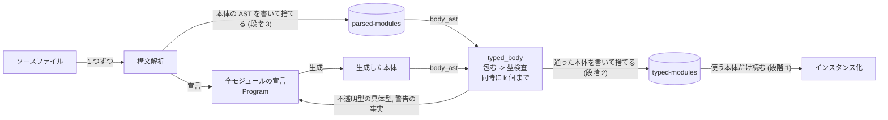
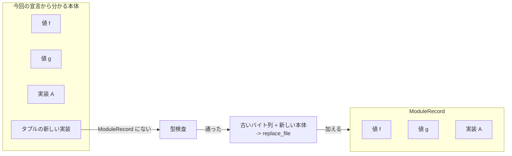

# 宣言と本体を分けるビルド

`fix build` と `fix check` が、std と依存ライブラリの全部を同時にメモリに持つのをやめる。全部の本体を毎回型検査するという言語の仕様は、そのままにする。対象の issue は #976、#985、#824、#343。

## 何を直すか

`fix build` は、プログラムが import するかどうかに関係なく、std と依存ライブラリの全モジュールを構文解析して型検査する。構文解析した AST と型付きの本体は、ビルドの終わりまでメモリに残る。そのため、次の三つの問題がある。

- **メモリ（#976）**: Fix 1.6.0 では、依存ライブラリを 26 個置いたプロジェクトで hello world をビルドすると、最大 RSS が 645 MiB に達する。2 回目以降のビルドでは 931 MiB を使う。Fix playground（Cloud Run）は、上限の 512 MiB でメモリ不足になった。
- **2 回目以降のビルドの時間（#985、#824）**: 型検査のキャッシュは、グローバル値の名前と型スキームの組ごとに 1 ファイルある。ビルドのたびに、使わない値のぶんまで読む。yukicoder のジャッジでは 6,930 ファイルを読み、ページキャッシュが空の状態で 13.2 秒かかる。
- **ストレージ（#343）**: ファイルが小さく数が多いので、ファイルシステムのブロック単位の切り上げで、ディスク上の量が中身の約 2 倍になる。コンパイラや依存の版を変えても、古いキャッシュキーのファイルは消えない。yukicoder の問題 1 つぶんのプロジェクトで、キャッシュは 26 MB から 38 MB ある。

## 目的

以下で、k はこの設計が同時に型検査する本体の数である。実装が選ぶ定数で、スレッド数の何倍か、または 1000 個程度にする。

- **型検査のフェーズのメモリ使用量**は O(全モジュールの宣言 + k × 最大の本体) にする。
- **インスタンス化から後のメモリ使用量**は O(全モジュールの宣言 + 使うコード) にする。インスタンス化は、ジェネリックなグローバル値を、使われる具体的な型ごとに特殊化した式を作る処理である。その後の AST の最適化は、インスタンス化した式の全体を対象にする。関数をまたぐ最適化を残すには、これが下限になる。
- **2 回目以降のビルドでキャッシュから読む量**は O(全モジュールの数 + 使う本体の数) にする。

「全モジュールの宣言」の量は、依存 26 個のプロジェクトで、型検査の直前に 98 MiB ある（付録の計測）。このプロジェクトの最大メモリ使用量は、これより下がらない。

次の三つは変えない。

- **全部の本体を型検査する。** 到達しない本体の型エラーでもビルドを止める。この検査を省くフラグは作らない。
- **報告するエラーと警告。** どの設定（`--deny-deprecated` など）でも、今と同じエラーと警告を、同じ位置で報告する。
- **生成するコード。** インスタンス化に渡す型付きの本体が今と同じなので、出力されるバイナリも同じになる。

対象は `fix build` と `fix check` である。言語サーバは今の形のまま残す。型検査のキャッシュのディスク上の量とコンパイル時間は、次の目標として扱う。簡単に減らせるものはこの設計に含め、そうでないものは後から追加できる形にしておく。

「使う」グローバル値とは、`main`（とテスト、エクスポートされた関数）から、インスタンス化が参照をたどって到達するグローバル値である。トレイトのメソッドは、呼び出しの型から選ばれた実装だけが到達する。import の数には左右されない。

## 今の流れ

`elaborate_via_config` は次の順に進む。

1. `load_source_files`: std と全部のソースファイルを構文解析し、全部の結果をそろえてから、モジュールを結合する。本体の AST は、`GlobalValue` の `expr` と、トレイトの実装の `TraitImpl::members` に入る。
2. 本体を生成し、宣言を検査する。
   - コンパイラが本体を生成する処理がいくつかある。`make_std_mod` は、整数の `Eq` の実装などを Rust で組み立てる。`make_tuple_traits_mod` は、使うサイズのタプルのトレイトの実装をソースとして生成して構文解析し、Std に足す。`add_methods` は構造体と union のアクセサを、`add_boxed_impls` は `Std::Boxed` の実装を作る。
   - 宣言の検査の対象は、型の定義、トレイト、`impl` の宣言部分（実装する型と制約）、型注釈である。
   - `desugar_opaque_types` は、不透明型を持つ値の本体を `wrap_with_opaque` で包む（下の「不透明型と `#wrap_opaque`」）。
3. `resolve_namespace_and_check_type_in_modules`: 全モジュールの全本体を型検査する。値ごとに、型検査のキャッシュがあれば、検査せずにそれを使う。トレイトの実装では、キャッシュを引く前に毎回、実装の型が宣言と一致するかを `check_scheme_equivalent` で検査する。型付きの本体は `Program::global_values` の各値に書き戻す。型付きの本体は、その値の不透明型の具体型も持っていて、これを `Program::opaque_types` に集める。
4. 型検査の後の警告を集める。非推奨の名前の使用と、構造体パターンに書かれていないフィールドの警告で、全部の型付きの本体を歩いて探す。出すかどうかは、設定の `deprecation_mode`（`--allow-deprecated` と `--deny-deprecated`）と、利用者自身のソースファイル（`root_source_files`）で決まる。この二つは、キャッシュキーに入っていない。
5. `instantiate_entry_io_value` と `instantiate_exported_values`: エントリポイントから要求された値だけを、型検査した本体からインスタンス化する。

全部の本体を先に型検査するのは、インスタンス化の前に、不透明型の具体型を全部そろえるためである。不透明型の具体型は、その不透明型を返す値の本体を型検査して初めて決まる。ある値をインスタンス化するとき、その型に別の値の不透明型が現れることがある。要求された順に型検査していくと、その別の値がまだ検査されていない場合が出てくる。

`fix check` は、言語サーバと同じ `SubCommand::Diagnostics` の経路を通る（`Configuration::check_mode`）。違うのは、キャッシュが `FileCache` であることだけである。

### 不透明型と `#wrap_opaque`

`repeat : [?it : Iterator, Item ?it = a] a -> I64 -> ?it` に対して、`desugar_opaque_types` は次のものを作る。

```
Std::repeat::#wrap_opaque : [x : Iterator, Item x = a] (a -> I64 -> x) -> (a -> I64 -> ?it a)
Std::repeat::#wrap_opaque = _undefined_internal([])
```

あわせて、`repeat` の型スキームを `a -> I64 -> ?it a` に書き換え、本体を `repeat = #wrap_opaque(|x, n| ...)` と包む。`?it a` は、不透明型を表す型構築子 `Std::repeat::?it` に `a` を適用した型である。トレイトのメソッドでは、`#wrap_opaque` をメソッドごとに 1 つ作り、各実装の本体を包む。

包んだ本体を型検査すると、本体の型が `#wrap_opaque` の引数の型と単一化され、`x` に具体型が入る。同時に、その具体型が `x` の制約を満たすことが検査される。適用の結果の型は `?it a` なので、`repeat` を使う側からは `?it a` しか見えない。型検査器は `x` に当たる型変数を記録し（`opaque_instantiations`）、型検査の後に `fill_opaque_concrete_types` がその具体型で `OpaqueTyConResolution` の右辺を埋める。

`#wrap_opaque` の本体は実行されない。インスタンス化の `instantiate_symbol` が、式の型を要求された型に合わせて型を確定させてから、`remove_opaque_wrapper_func` で適用ごと外す。

## 新しい流れ

宣言は全モジュールの分を持つ。本体は、必要なときに必要な分だけ取り出し、使い終わったら捨てる。

フェーズごとにメモリに載るものは、次のように変わる。

| フェーズ | 今 | 新しい流れ |
| --- | --- | --- |
| 構文解析 | 宣言 + 全ファイルの本体の AST | 宣言 + 1 ファイル分の本体の AST |
| 全本体の型検査 | 宣言 + 全部の型付きの本体 | 宣言 + 処理中の k 個の本体 |
| インスタンス化から後 | 宣言 + 全部の型付きの本体 + インスタンス化した式 | 宣言 + 使う型付きの本体 + インスタンス化した式 |

ここで「宣言」には、コンパイラが生成した本体を含める（下の「本体の出どころ」）。

そのために、二つのキャッシュをソースファイルごと、モジュールごとのファイルにする。

- **`.fixlang/cache/parsed-modules`**: 構文解析した本体の AST。ソースファイルごとに 1 ファイル。
- **`.fixlang/cache/typed-modules`**: 型付きの本体と、その要約の `ModuleRecord`。モジュールごとに 1 ファイル。

1 回目のビルドで、本体は次の道を通る。矢印の横の段階は、その矢印を入れる段階である（下の「段取り」）。



今の 1 値 1 ファイルのキャッシュのフォルダ `.fixlang/cache/typecheck` は、読みも書きも消しもしない。利用者が `fix clean` を実行すると消える。フォルダを分けるので、新しいコードが今の形のファイルを目にすることはなく、古い版のコンパイラと同じプロジェクトで使っても、互いのファイルを消し合わない。

### 本体の出どころ

型検査する本体は、出どころで二つに分かれる。

- **ソースから構文解析した本体**: 利用者と std と依存ライブラリの値、およびタプルのトレイトの実装（生成したソースを構文解析したもの）。parsed-modules に書いてメモリから捨て、必要なときに `body_ast` で読み戻す。
- **コンパイラが宣言から生成した本体**: アクセサ、`Std::Boxed` の実装、Rust で組み立てる std の実装。メモリに持ち続ける。量が宣言の量に比例する（アクセサは構造体のフィールドの数、実装は型の数で決まる）ので、目的の上限を外れない。依存 26 個で、シリアライズした大きさは本体全体の約 1 割である。

不透明型で本体を包む処理は、`desugar_opaque_types` から、本体 1 つを型検査する関数の入口へ移す。`desugar_opaque_types` には宣言の側の処理を残す。不透明型の型構築子と制約の登録、型スキームの書き換え、`#wrap_opaque` の生成に加えて、値と実装ごとに、包むのに使う `#wrap_opaque` の名前と、右辺が空の `OpaqueTyConResolution` の列を宣言の側に持たせる。型検査の入口は、本体の AST をこの名前で包み、この列を型付きの式に写してから型検査する。どの出どころの本体も、型検査の直前にこの入口を通るので、包む処理がかかる場所は一か所になる。parsed-modules に書く AST は包む前のものなので、その中身はソースファイルと構文解析の設定だけで決まる。

### parsed-modules

- **書く時点**: ソースファイルを 1 つ構文解析するたびに、その本体の AST を書いて捨てる。どのモジュールに `ModuleRecord` があるかは、全ファイルを構文解析するまで分からない（キャッシュキーが import をたどった先のソースからも決まる）。そこで、記録の有無とは関係なく書く。こうすると、構文解析のフェーズでメモリに載る本体の AST は、ファイル 1 つ分で済む。
- **キャッシュキー**: ソースファイルの中身のハッシュ、コンパイラのビルド時刻、構文解析が依存する設定（`c_numeric_types` と、doc test のソースの名前の付け替え）。ソースが変わっていないファイルについては、2 回目以降のビルドで何も書かない。書き終えたら、同じソースファイルの、キャッシュキーの違うファイルを消す。
- **位置**: AST は、型注釈の `TypeNode` の位置も含めてシリアライズする。今のシリアライズは `TypeNode` の位置を落とす（`#[serde(skip)]`）ので、そのままでは、読み戻した本体の型注釈のエラーに位置が付かない。

### typed-modules と `ModuleRecord`

モジュールごとに 1 ファイルを置く。キャッシュキーは今と同じ `module_dependency_hash` で、モジュールが依存するソースのハッシュ、構文解析と型検査が依存する設定（`elaboration_hash`）、コンパイラのビルド時刻から作る。ファイル名は、モジュール名を一対一に符号化したものと、キャッシュキーのダイジェストから作る（今の `cache_file_name` のように英数字以外を `_` にすると、`A.B` と `A_B` が同じ名前になる）。

```rust
/// What a module's file records of one body.
struct EntityEntry {
    /// Where the body's identity and typed expression lie in the file.
    body: Range<u64>,
    /// The concrete type each opaque type constructor of the body stands for.
    opaque_types: Map<FullName, Vec<OpaqueTyConResolution>>,
    /// The facts about the body a warning after type checking may be derived from.
    warning_facts: Vec<WarningFact>,
}

/// The bodies a module's file holds, by their identity.
type ModuleRecord = Map<EntityIdentity, EntityEntry>;

/// A fact about a typed expression that a warning after type checking may be
/// derived from, whatever the configuration.
enum WarningFact {
    /// The expression uses the global value `name` at `span`.
    GlobalUse { name: FullName, span: Span },
    /// A struct pattern at `span` names the fields `written` of `tycon`, and
    /// writes no `_` after them.
    StructPattern { span: Span, tycon: Arc<TyCon>, written: Vec<Name> },
}
```

ファイル 1 つの中身は、次の順に並ぶ。ID は各本体の前に書いた `EntityIdentity` である。末尾の footer は、`ModuleRecord` の位置と長さと、このコンパイラが書いたファイルであることを示す 8 バイトを持つ。

```
[ID][本体 A] [ID][本体 B] [ID][本体 C] ... [ModuleRecord] [footer]
```

2 回目以降のビルドは、全モジュールの `ModuleRecord` を毎回読む。本体は、インスタンス化が要求したものだけを、`ModuleRecord` で場所を引き、ID を照合して読む。

- **`EntityIdentity`**: 型検査の 1 単位を指す。グローバル値なら名前と型スキーム、トレイトのメソッドの実装なら、メソッドの名前と実装の型スキームと実装を書いたモジュールである。今のキャッシュのキーと同じものを指す。
- **`ModuleRecord` が保証すること**: `ModuleRecord` にある各本体が、同じキャッシュキーのもとで、診断を 1 つも出さずに型検査を通ったこと。診断を 1 つも出さない型検査とは、通常のビルドの型検査（`error_tolerant` でない検査）が、エラーも、穴（`?`）などの許容された診断も出さなかったことを指す。今のキャッシュも、この条件を満たした結果だけを書く。トレイトの実装なら、実装の型が宣言と一致すること（`check_scheme_equivalent`）も含む。
- **2 回目以降のビルド**: 宣言から分かる今回の本体の集合と `ModuleRecord` を比べ、`ModuleRecord` にある本体は型検査を省く。`ModuleRecord` にない本体だけを型検査する。Std の本体の集合は、使うタプルのサイズで増える（9 要素のタプルを使うと Std の値が 107 個増え、Std のキャッシュキーは変わらない）。集合で比べるので、こうして増えた本体も型検査される。
- **新しく通った本体を加える**: その時点のファイルを読み直し、古い本体のバイト列を同じ位置にそのまま写し、新しい本体を足して、`ModuleRecord` を書き直した新しいファイルを作り、`replace_file` で置き換える。古い本体の位置が変わらないので、前に読んだ `ModuleRecord` の位置は、書き直した後のファイルでも同じ本体を指す。ただし、同じモジュールのファイルを 2 つのビルドが同時に書き始めると、それぞれのファイルは同じ本体を別の位置に持ち、後から置き換えた方が残る。そのため、記録した位置で本体が読めないときは、そのときのファイルの `ModuleRecord` を読み直して位置を引き直す。Std のファイルは約 7 MB で、書き直しは数十 ms の見込みである。`ModuleRecord` の本体は増える一方なので、タプルのサイズが違う `fix build` と `fix test` を交互に実行しても、両方を一度ずつ実行した後は型検査し直さない。
- **診断の出た本体**: ファイルに書かない。毎回型検査し直す。
- **古いファイル**: 新しいキャッシュキーのファイルを書き終えたら、同じモジュールの、キャッシュキーの違うファイルを消す。
- **キャッシュキーが成り立つ条件**: 本体の中身は、その `EntityIdentity` と、モジュールのキャッシュキーが覆うもので決まる。たとえば、タプルの実装の中身はサイズだけで決まり、アクセサの中身はそのモジュールの構造体の定義で決まる。今の値ごとのキャッシュも同じ条件に立っている。実装では、この条件をコメントと assert に書く。

2 回目以降のビルドで型検査する本体は、次のように決まる（段階 1 から）。図では、新しいサイズのタプルを使ったので、実装が 1 つ増えている。



### 型検査の後の警告

警告は、`ModuleRecord` の `warning_facts` と、今回の設定と宣言から、毎回のビルドで出し直す。今回の型検査で得た型付きの本体については、同じ事実をその場で取り出して使う。

- **非推奨の名前の使用**: `GlobalUse` のうち、使った値が今回の宣言で非推奨のものを、`deprecation_mode` に従って警告かエラーにする。位置が利用者自身のソースファイルにないものは出さない。
- **構造体パターンに書かれていないフィールド**: `StructPattern` の `written` と、今回の宣言の構造体のフィールドを比べる。

キャッシュには設定に依存しない事実だけを持ち、設定に依存する判断は毎回する。そのため、`--allow-deprecated` でビルドした後に `--deny-deprecated` でビルドすると、今と同じくエラーで止まる。警告の出るモジュールも、2 回目以降のビルドで型検査し直さずに済む。

### 本体を取り出す関数

本体を得る手段を、次の 2 つの関数にまとめる。全本体を型検査するフェーズもインスタンス化も、本体はこの 2 つからだけ取る。呼び出す側は、本体がどこから来たか（ファイルから読んだか、作り直したか）を知らない。

```rust
/// The AST of the body of `entity` as the parser produced it: read from
/// parsed-modules, or parsed from its source file when that has none.
/// Bodies the compiler generates are held in memory and returned from there.
fn body_ast(&self, entity: &EntityIdentity) -> Result<Arc<ExprNode>, Errors>

/// The result of type-checking `entity`: read from typed-modules, or
/// type-checked from `body_ast(entity)` when that has none.
fn typed_body(&self, entity: &EntityIdentity) -> Result<CheckedBody, Errors>

/// What one type check yields besides the typed expression, which the caller
/// merges into the program: the concrete types of the opaque types, the
/// diagnostics, and the warning facts.
struct CheckedBody {
    typed: TypedExpr,
    opaque_types: Map<FullName, Vec<OpaqueTyConResolution>>,
    diagnostics: Errors,
    warning_facts: Vec<WarningFact>,
}
```

どちらの関数も、ファイルがない、壊れている、書けなかった、のどの場合も「なかった」として作り直すので、結果は同じになる。違うのは、かかる時間だけである。本体を読むときは、本体の前に書いた `EntityIdentity` が求めたものと一致することを確かめる。別のプロセスが置き換えたファイルで本体の位置が変わっていたときは、そのファイルの `ModuleRecord` から位置を引き直す。別のキャッシュキーのファイルに置き換わって消えたときは、本体を型検査し直す。

読み戻した位置（`Span`）は、ソースファイルをパスで共有する `SourceFile` を指すようにする。今のシリアライズは `SourceFile` の中身を落とすので、読み戻した位置はそれぞれ別の `SourceFile` を持つ。`-g` のビルドでは、デバッグ情報の行番号を求めるたびに、その `SourceFile` がファイル全体（std.fix は 743 KB）を読んで持つ。そのため、今の 2 回目以降のビルドは、`-g` で最大 RSS が 327 MB から 766 MB になっている。

### 全本体を型検査するフェーズ

```
targets = every entity of every module that its module's record lacks

run targets on the compiler threads, at most k in flight:   // モジュールをまたいで流す
    checked = typed_body(entity)        // body_ast -> 不透明型で包む -> check_scheme_equivalent -> 型検査
    keep  checked.opaque_types, checked.diagnostics, checked.warning_facts
    if checked.diagnostics is empty:
        append checked.typed to the new file of its module   // old bodies first, copied when it begins
    free  checked.typed
    if entity is the last target of its module:
        finish the new file (record, index); replace the file with it

opaque types  = from the records + from the checked
validate_opaque_types_are_acyclic(opaque types)
warnings      = derive from the warning facts of the records + of the checked
report all diagnostics and warnings; stop on an error
```

今は全部の型検査を `map_on_compiler_threads` に一度に渡していて、1 本の重さが大きくばらついても、空いたスレッドが次を取る。モジュールごとや k 個ごとに完了を待つと、並列度が落ちる。そこで、対象の本体を全モジュールにわたって一つの作業の列に入れ、同時に処理中の本体を k 個までに抑える。k はコンパイラのスレッドの数で、各スレッドは型検査を終えた本体を呼び出し側のスレッドへ渡してから次を取る。呼び出し側のスレッドは、渡された本体をすぐにモジュールの新しいファイルへ書き足すので、モジュールの最後の本体を待つ間も、書いた本体はメモリに残らない。

このフェーズが終わると、すべての値の不透明型の具体型が決まっている。型検査のエラーを全部報告してからインスタンス化に進む順序も、今と同じである。

`fix check` は、このフェーズで終わる。型検査の結果をどこに持つかを、設定の `TypeCheckStore` で表す。`TypedModules` は typed-modules のファイルに持ち、`InMemory` は呼び出し側が持つメモリのキャッシュに持つ。`fix build` と `fix check` は `TypedModules`、言語サーバは `InMemory` を使うので、`fix check` だけがこの流れを通る。言語サーバと `fix edit explicit-import` は、今の `SubCommand::Diagnostics` の経路のまま、本体を全部メモリに持つ。言語サーバは、型検査しない依存ライブラリの本体の AST もたどるからである（参照の検索、名前の変更、セマンティックハイライト、補完）。

### インスタンス化

typed-modules に書く型付きの本体は、今のキャッシュが書く `TypedExpr` と同じもので、不透明型を持つ値では `#wrap_opaque` の適用を含む。外すのは今と同じくインスタンス化である（上の「不透明型と `#wrap_opaque`」）。この後の処理は変えない。

エントリポイントから要求された値の型付きの本体を、`typed_body` で取り出す。通常は、全本体を型検査するフェーズが書いたばかりのファイルか、もとからあるファイルから読む。同じジェネリックな値は、型ごとに何度も要求される。そこで、インスタンス化の間は、一度読んだ型付きの本体をメモリに持つ。持つのは使う本体だけなので、目的の上限（宣言 + 使うコード）に収まる。

### トレイトの実装の本体

トレイトの実装の本体は、`GlobalValue` の `TraitMemberImpl` と、`TraitEnv` の `TraitImpl::members` の両方から、同じ `Arc` で参照されている。`create_typechecker` は `TraitEnv` を複製して型検査器に持たせる。そのため、`GlobalValue` の側の本体を捨てても、本体は残る。`members` は名前だけを持つ形にし、本体は `GlobalValue` の側にだけ置く。

`TraitImpl::members` の本体を読む処理は、名前を調べるもののほかに、`validate_trait_impl` の 2 つの検査がある。

- トレイトが宣言していないメンバを実装したときの報告は、本体の `source` を位置に使う。
- 型シグネチャを書かないメンバについて、本体の型注釈の型変数が実装の型に現れることを確かめる（`collect_annotation_tyvars`）。

`members` を名前だけにするときは、この 2 つが読むものを、本体の AST を捨てる前に取り出しておくか、検査を本体の AST を読み戻す場所へ移す。

### 2 回目以降のビルド

何も編集していなければ、全部の本体が `ModuleRecord` にある。読むのは、全モジュールの `ModuleRecord` と、インスタンス化が要求した本体だけである。依存 26 個のプロジェクトなら、9,904 ファイルの代わりに、271 ファイルの `ModuleRecord` と、使う本体のぶんを読む。利用者が自分のモジュールを編集したときは、そのモジュールと、それに依存するモジュールだけを型検査し直す。

短くなるのは型検査のフェーズである。依存 26 個のプロジェクトの 2 回目以降のビルドでは、CPU 12 個で 1.53 秒のうち 0.44 秒、ページキャッシュを破棄した CPU 1 個で 2.99 秒のうち 2.01 秒が、このフェーズにかかっている。全ソースの構文解析と宣言の処理は残る。

## 段取り

三つの段階に分け、段階ごとに PR を出す。段階 2 は段階 1 の typed-modules に型付きの本体を書くので、段階 1 を先に入れる。

### 段階 1: typed-modules と `ModuleRecord`、要求された本体だけを読むインスタンス化

- キャッシュを typed-modules にする。`ModuleRecord` にある本体は、実装の型の検査も型検査も省く。
- 型検査の後の警告を `warning_facts` から出す。
- インスタンス化は `typed_body` で本体を取り出す。読み戻した位置の `SourceFile` を共有する。
- `fix check` を言語サーバの経路と区別する（`TypeCheckStore`）。
- `ModuleRecord` にない本体は、この段階では今と同じく全部を型検査してメモリに持つ。

改善するもの: #985 と #824 の、キャッシュから読む量。#343 の大半。2 回目以降のビルドのメモリ（使わない型付きの本体を読まなくなる）。

この段階を入れた後、playground のサーバの Dockerfile で、テンプレートのプロジェクトを一度ビルドしておく。今はイメージにキャッシュがなく、リクエストのたびに 1 回目のビルドになっている。キャッシュは相対パスで書かれているので、プロジェクトを複製してもキャッシュに当たる。

### 段階 2: 本体を k 個までずつ型検査し、書いて捨てる

- 全本体を型検査するフェーズを、上の擬似コードの形にする。型付きの本体は、型検査したそばから typed-modules に渡して捨てる。

改善するもの: 1 回目のビルドのメモリのうち、型検査のぶん（依存 26 個で約 320 MiB）。

### 段階 3: 本体の AST を parsed-modules に書いて捨てる

- ソースファイルを 1 つ構文解析するたびに、本体の AST を位置ごと parsed-modules に書いて捨てる。
- 不透明型で本体を包む処理を、型検査の入口へ移す。
- `body_ast` を作る。
- `TraitImpl::members` を名前だけにする。`GlobalValue` の側の本体を捨てるこの段階で、はじめてメモリが減る。

改善するもの: 構文解析のぶんのメモリ（依存 26 個で約 100 MiB）。

### 段階ごとに測るもの

- 最大 RSS: 依存なしと依存 26 個のプロジェクトの hello world を、1 回目と 2 回目以降のビルドで、CPU 1 つで測る。`-g` の有無の両方で測る。
- 2 回目以降のビルドの時間: CPU 1 つで、キャッシュのファイルがページキャッシュに載っている場合と、ページキャッシュから破棄した場合を測る。9 要素のタプルを足したときの 2 回目のビルドも測る。
- 1 回目のビルドの時間: 並列度が落ちていないことを、CPU 12 個で確かめる。
- キャッシュのファイルの数と、ディスク上の量。
- 報告が変わらないこと: `--allow-deprecated` の後の `--deny-deprecated`、型注釈のエラーの位置。
- 生成するコードが変わらないこと: 変更の前後で同じプログラムをビルドし、`.text` と `.rodata` を比べる。

## この設計の対象外

どれも、この設計を変えずに後から追加できる。

- **構文解析の結果のキャッシュ**: 2 回目以降のビルドの時間の 24% は Std の構文解析である。parsed-modules のファイルに宣言も入れれば、ソースが変わらないファイルの構文解析そのものを省ける。
- **`Arc` の共有を保つ型のテーブル**: postcard は `Arc<TypeNode>` の共有を保存しないので、読み戻した本体では共有されていた型が複製される。typed-modules のファイルに型のテーブル（型を番号で引く表）を置き、本体は番号で型を指す形にできる。
- **終了時の `Program` の解放を省く**: 2 回目以降のビルドの時間の 7% を占める。`Program` が保持するデータが減るぶん、この設計でも短くなる。
- **`.fixlang/deps` の `.git`**: 依存ライブラリの clone の約半分を占める。依存を取得する仕組みの側の話なので、別の issue にする。

---

# 付録

## 決まったこと

| 問い | 答え |
| --- | --- |
| 目的の範囲 | 型検査のフェーズは O(宣言 + k × 最大の本体)、インスタンス化から後は O(宣言 + 使うコード)。k は同時に型検査する本体の数。対象は `fix build` と `fix check` で、言語サーバは含めない。 |
| #985 の扱い | 2 回目以降に読む量を目的に入れ、一つの設計で扱う。到達しない本体の型検査を省くフラグは作らない。 |
| インスタンス化に必要な本体の取り出し方 | 先に全部を型検査してキャッシュに書いて捨て、インスタンス化は「キャッシュから読む。なければ型検査する」で取り出す。 |
| ストレージとコンパイル時間 | 次の目標。簡単に減らせるならこの設計に含め、そうでなければ将来減らせる形にする。 |
| `ModuleRecord` が保証するもの | 通った本体（`EntityIdentity`）ごとの、ファイルの中の位置と、不透明型の具体型と、警告の元になる事実。今回の本体の集合と比べ、記録にないものだけを型検査し、通ったらファイルを作り直して加える。 |
| 型検査の後の警告 | 警告の元になる事実を `ModuleRecord` に入れ、毎回の設定と宣言から出し直す。 |
| キャッシュのファイルの形 | モジュールごとに 1 ファイル（型付きの本体 + `ModuleRecord`）。古いキャッシュキーのファイルは、書くときに消す。 |
| 今の形のキャッシュの扱い | 新しい形は別のフォルダ（`.fixlang/cache/typed-modules`）に置く。今のフォルダ `.fixlang/cache/typecheck` は消さない。 |
| 本体の AST の持ち方 | ソースから構文解析した本体は parsed-modules に書いて捨て、`body_ast` で読み戻す。ファイルになければソースファイルを構文解析する。生成した本体はメモリに持つ。不透明型で包む処理は型検査の入口へ移す。 |
| 構文解析の結果の置き場所 | `.fixlang/cache/parsed-modules` にソースファイルごとに置き、ビルドをまたいで残す。 |
| 言語サーバ | 今の形のまま残す。本体を捨てるのは `fix build` と `fix check` の経路だけ。 |
| 段取り | 段階 1 -> 段階 2 -> 段階 3 の順に、段階ごとに PR を出す。段階 1 の後、playground の Dockerfile でビルドしておく。 |

## 計測で分かったこと

- 最大メモリは型検査のフェーズで決まる。hello world では、インスタンス化から後にほとんど増えない。
- 構文解析の結果の約 8 割は本体の AST である（依存 26 個で 122 MiB のうち約 97 MiB）。
- 型検査の直前の宣言は、依存 26 個で 98 MiB ある。
- コンパイラが生成した本体は数が多いが、シリアライズした大きさは本体全体の約 1 割である。
- 本体の AST は、構文解析し直すより、シリアライズして読み戻すほうが速い。
- 2 回目以降のビルドが 1 回目より多くのメモリを使うのは、読み戻した `Arc` の中身が共有されずに複製されるためである。`-g` では、読み戻した位置ごとにソースファイルの中身を持つので、さらに多くなる。
- Std の本体の集合は、Std のキャッシュキーが同じでも、使うタプルのサイズで増える。

## 計測

メモリの内訳を見るため、コンパイラが普段使う mimalloc の代わりに、glibc の malloc で動くようにした計測用のビルドを使った。CPU は 1 つ（`taskset -c 0`）。依存 26 個のプロジェクトは、Fix playground のサーバの Dockerfile と同じ依存の組である。

### 処理の各時点の使用中のヒープ

| プロジェクト | 構文解析の後 | 本体を捨てた後 | 型検査の後 | 最後 |
| --- | ---: | ---: | ---: | ---: |
| 依存なし、1 回目 | 37 MiB | 7 MiB | 117 MiB | 116 MiB |
| 依存なし、2 回目以降 | 37 MiB | 7 MiB | 186 MiB | 185 MiB |
| 依存 26 個、1 回目 | 122 MiB | 25 MiB | 441 MiB | 435 MiB |
| 依存 26 個、2 回目以降 | 122 MiB | 25 MiB | 728 MiB | 724 MiB |

「本体を捨てた後」は、構文解析の直後に全部の本体の AST（トレイトの実装の本体を含む）を捨てて測った値である。

### 型検査の直前（依存 26 個）

| 時点 | 使用中のヒープ |
| --- | ---: |
| 型検査の直前 | 231 MiB |
| 型検査の直前に、全部の本体と型検査器を捨てた後 | 98 MiB |

型検査の直前の本体は 9,904 個で、シリアライズすると 14.5 MB になる。そのうちソースの位置を持たない本体（ほぼ、コンパイラが生成した本体）は 6,690 個で、1.4 MB だった。

### 2 回目以降のビルドの時間（依存 26 個）

| CPU | ページキャッシュ | 型検査のフェーズ | ビルド全体 |
| --- | --- | ---: | ---: |
| 12 個 | 載っている | 0.44 秒 | 1.53 秒 |
| 1 個 | 載っている | 0.96 秒 | 1.92 秒 |
| 1 個 | 破棄した | 2.01 秒 | 2.99 秒 |

キャッシュの全ファイルに `posix_fadvise(DONTNEED)` をかけて、ページキャッシュから破棄した。

### 本体の AST のシリアライズ

| プロジェクト | 構文解析 | 本体の数 | 大きさ | 書く | 読み戻す |
| --- | ---: | ---: | ---: | ---: | ---: |
| 依存なし | 0.17 秒 | 1,414 | 3.9 MB | 8 ms | 35 ms |
| 依存 26 個 | 0.50 秒 | 3,965 | 13.0 MB | 30 ms | 92 ms |

### `-g` のビルドの最大 RSS（hello world、依存なし、CPU 1 つ）

| 条件 | 1 回目 | 2 回目以降 |
| --- | ---: | ---: |
| `-g` | 242 MB | 766 MB |
| `-g` なし | 259 MB | 327 MB |

2 回目以降は、型検査のキャッシュだけを残し、コード生成をやり直させて測った。

### yukicoder の問題のプロジェクトのストレージ

| 内訳 | 依存 20 個 | 典型的なもの |
| --- | ---: | ---: |
| 型検査のキャッシュ（ディスク上の量） | 38 MB / 6,934 ファイル | 26 MB / 4,551 ファイル |
| そのうち中身の大きさ | 18 MB | 12 MB |
| `.fixlang/deps` | 11 MB | 4.2 MB |

## ほかの設計との比較

- v1.3.0 より前は、`instantiate_symbol` が、要求された値をその場で型検査していた。到達しない本体は型検査しなかったので、使っていないコードの型エラーは報告されなかった。インスタンス化の前に不透明型の具体型をそろえるため、全部を先に型検査する今の形になった。
- ほかのコンパイラでは、GHC はモジュールを、Swift はファイルを型検査の単位にしていて、ほかの単位については宣言だけを見る（GHC ではインターフェースファイル `.hi`）。Zig は到達する本体だけを解析するので、使わない関数のエラーが出ないという不満が利用者から出ている（[Ziggit の議論](https://ziggit.dev/t/lazy-compilation-causing-no-compile-errors-within-unused-functions-is-a-headache/11821)）。Fix はグローバル値に型注釈が必須なので、本体を 1 つずつ型検査できる。
- 「到達しないグローバル値を型検査しない」案は、言語の仕様を変えるので採らなかった。
